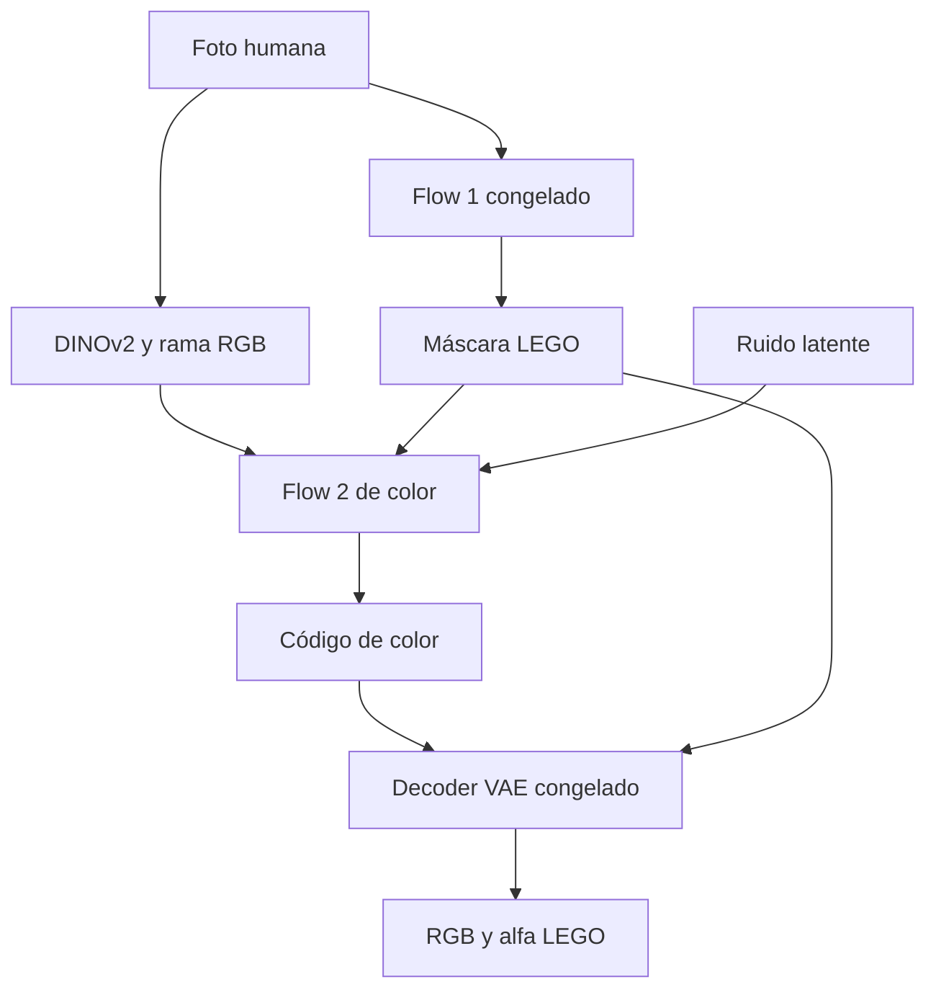

# Flow 2 y VAE de color: guía de estudio del código

Actualizado el 15 de noviembre de 2026. Esta guía corresponde a `Flow2_Color_LEGO_Completo.ipynb`, versión de configuración `flow2_v1`, y al codec `vae_control` entrenado en `ptd-lego-caras-vae2_actualizado.ipynb`. Explica la implementación y su razón de ser. Los registros reales se distinguen de los ejemplos didácticos y de los experimentos que todavía no se han hecho.

El documento anterior se conserva al final como anexo de decisiones y literatura. Aquí se desarrolla lo que allí estaba resumido: las distribuciones de la VAE, las entradas y normalizaciones, la atención, el objetivo de flow matching, CFG, el curriculum, las métricas y la forma de continuar un entrenamiento.

## Recorrido de lectura

1. Qué aprende cada modelo y qué permanece congelado.
2. Cómo se preparan los datos y se evitan fugas entre particiones.
3. La VAE de color: arquitectura, pérdidas y códigos objetivo.
4. Normalizaciones y celdas activas.
5. La foto: DINOv2 y rama RGB.
6. La máscara y las dos arquitecturas de Flow 2.
7. Atención, RoPE, normalización de Q/K y AdaLN-Zero.
8. Entrenamiento con flow matching y pérdida auxiliar RGB.
9. CFG explicado con su fórmula y su implementación.
10. Generación por integración numérica.
11. Curriculum, pseudoetiquetas y condiciones exactas de avance.
12. Optimizador, acumulación, AMP, EMA y scheduler.
13. Validación, R codec y lectura de tus registros.
14. Best, last, reanudación y entrenamiento más largo.
15. Evaluación completa, inferencia y ZIP.
16. Cómo llevar estas técnicas a otros proyectos.

## 1. Qué tarea aprende cada componente

La entrada de producción es una foto humana. Flow 1 genera una máscara LEGO; Flow 2 recibe esa máscara y la foto, y genera el código latente de color. El decoder de color convierte ese código en RGB dentro de la máscara. La salida final es una imagen RGBA, con la máscara como canal alfa.

Hay dos tareas distintas: decidir la forma de ojos, boca o barba, y decidir los colores de los elementos que existen en esa forma. Separarlas permite comprobar si un fallo viene de la geometría, de la predicción del color o del codec que reconstruye ese color.

En entrenamiento se dispone del LEGO coloreado objetivo. Se codifica para obtener el destino que debe aprender Flow 2. En producción ese LEGO objetivo no existe y el código se genera desde ruido.

| Componente | Recibe | Produce | Durante Flow 2 |
|---|---|---|---|
| DINOv2 | Foto normalizada | Características semánticas | Congelado |
| Flow 1 y su DiTo | Características de la foto y ruido | Máscara | Congelados |
| Encoder VAE de color | RGB LEGO y máscara | Media latente | Congelado |
| CNN de color y proyecciones | Foto RGB y características DINO | Condición fotográfica | Entrenables |
| CNN de máscara | Máscara | Características geométricas | Entrenable |
| DiT de Flow 2 | Código ruidoso, tiempo y condiciones | Velocidad latente | Entrenable |
| Decoder VAE de color | Código y máscara | RGB LEGO | Congelado |

Flow 2 comienza con pesos nuevos. Reutiliza el diseño de ciertos bloques del Flow 1, pero no copia sus pesos como inicialización. Reutilizar una arquitectura y transferir parámetros son decisiones diferentes.

La analogía con generación de textura 3D se limita a condicionar la apariencia por una geometría conocida. Este notebook trabaja en imágenes 2D; no produce ni empareja por sí mismo una malla 3D.

## 2. Preparar datos sin confundir fotos, formas y colores

### 2.1. Qué significa una muestra

Una fila enlaza una foto humana con una estampa LEGO. Varias fotos pueden tener el mismo objetivo. A su vez, dos estampas pueden compartir la máscara y tener colores distintos. Por eso no se deben deduplicar objetivos de color usando solamente el alfa.

`canonical_rgba` coloca cada estampa en un lienzo de 128×128, centrada y sin redimensionarla. Convierte el alfa en binario con umbral 128 sobre valores uint8, y pone el RGB a cero fuera de la máscara. Rechaza estampas sin alfa, mayores que el lienzo o con máscara vacía/completa. Esta convención define el espacio de coordenadas usado por todo el pipeline.

Los identificadores `real:` e `int:` separan originales de intermedias. Los alias enlazan nombres del catálogo con el índice de color `color_i`. Los hashes SHA-256 comprueban que se encontró el archivo esperado, incluso si hay nombres repetidos en varios datasets.

### 2.2. La partición también forma parte del modelo

El notebook conserva las particiones auditadas de Flow 1. Si una estampa estaba reservada por el protocolo de la VAE de color, no la usa para entrenar Flow 2 aunque su fila figure como train de Flow 1: pasa a `reserva_codec`.

Esto importa porque la VAE se entrenó sin adjuntar la partición auditada de Flow 1 y sus reservas de intermedias pueden diferir. El código usa la intersección de los train autorizados, en vez de volver a repartir todo al azar. También comprueba que una misma estampa no cruce train y validación/test de Flow 2, y que fotos con el mismo contenido no crucen particiones.

Se guarda `codec_color_vio_objetivo`: permite separar una foto nueva cuyo LEGO ya vio el codec de una foto cuyo objetivo tampoco vio el codec. Son preguntas de generalización diferentes.

### 2.3. Muestreo equilibrado por objetivo

`RowSampler` primero elige una estampa de train y después una de sus fotos. Así una estampa con diez personas no domina automáticamente a otra que tiene dos. El muestreo es con reemplazo, por lo que los pasos resultan más claros que las épocas para describir este entrenamiento.

El panel fijo usa un recorrido equilibrado entre estampas. Por defecto contiene 48 fotos de validación y 100 de test. En tu registro, `Objetivos train: 1581` significa **1581 objetivos de color distintos autorizados para train**, no 1581 fotos en total. El cache de 7582 fotos incluye otras particiones y no implica que todas entrenen la red.

**Para reutilizar:** cuando varios ejemplos comparten una etiqueta, un paciente o una pieza, define qué entidad debe tener el mismo peso. El tamaño del CSV no siempre representa la diversidad efectiva.

## 3. La VAE de color que ya entrenaste

### 3.1. Qué comprime

La VAE recibe RGB en [0,1] y máscara binaria: cuatro canales de 128×128. Su encoder usa convoluciones, bloques residuales con GroupNorm y SiLU, y tres reducciones espaciales por factor dos. Los anchos son 32, 64 y 128 canales; la cuadrícula pasa de 128 a 64, 32 y 16.

La cabeza final produce 16 canales y los divide en dos tensores de 8×16×16: la media μ y el logaritmo de la varianza, `logvar`. Este último se limita al intervalo [-10,10] para evitar valores extremos durante el cálculo exponencial.

Durante el entrenamiento de la VAE se muestrea:

$$
z=\mu+\exp(\tfrac12\,\mathrm{logvar})\odot\epsilon,
\qquad \epsilon\sim\mathcal N(0,I).
$$

La reparametrización permite que el gradiente de reconstrucción llegue a μ y a la escala del ruido. La base de este mecanismo es [Auto-Encoding Variational Bayes](https://arxiv.org/abs/1312.6114).

En evaluación, y en `encode` usado por Flow 2, se toma **μ**, sin muestrear esa gaussiana. Esto deja un objetivo estable para el flow. La aleatoriedad generativa de Flow 2 procede de su propio ruido inicial.

### 3.2. Cómo reconstruye respetando la forma

El decoder recibe el código de ocho canales y la máscara reducida a 16×16. Vuelve a introducir la máscara en sus distintas resoluciones, usa bloques residuales y subidas con PixelShuffle, y termina con tres canales RGB.

La salida es:

$$
\hat y=\operatorname{sigmoid}(D(z,m))\odot m.
$$

La sigmoid limita los colores a [0,1]. Multiplicar por la máscara anula el fondo. La geometría de salida queda impuesta por la condición; el código no necesita gastar toda su capacidad en describir dónde hay transparencia.

### 3.3. Pérdida y regularización de la VAE

La libreta de color entrenó con MSE dentro de la máscara más una penalización KL:

$$
L_{\mathrm{VAE}}=L_{\mathrm{RGB}}+\beta(s)L_{\mathrm{KL}},
$$

$$
L_{\mathrm{KL}}=\operatorname{promedio}_{\text{canales y celdas activas}}
\left[-\tfrac12(1+\mathrm{logvar}-\mu^2-e^{\mathrm{logvar}})\right].
$$

En esa libreta, β llega a `1e-4` durante el primer 10% de los 6000 pasos, es decir, unos 600 pasos. Se llama calentamiento de KL: al principio deja más espacio para aprender reconstrucción y luego aumenta la regularización. El valor de β depende de cómo se normalizan las pérdidas; no se puede copiar a otra implementación sin revisar sus escalas.

La reconstrucción empuja a conservar información útil; KL penaliza separarse de una normal estándar. El resultado es un compromiso, no una obligación de crear una isla totalmente aislada por muestra. El decoder comparte parámetros entre todas las estampas y la representación puede compartir estructura. Tampoco hay una garantía de que cada eje aprenda una característica interpretable.

Con KL pequeño y objetivos de alta fidelidad, una buena reconstrucción no basta para asegurar buen muestreo directo desde una normal estándar. En este pipeline se aprende un **prior adicional con Flow 2**, condicionado por persona y máscara, sobre los códigos que realmente produce el encoder.

El solapamiento de posteriors tampoco obliga a que el entrenamiento falle: regiones compartidas pueden representar factores comunes y aceptar cierta pérdida de reconstrucción a cambio de regularización. Si se superponen demasiado códigos de imágenes incompatibles, sí aparece ambigüedad. La varianza describe incertidumbre del encoder, pero no es un control directo de cuánto se combinan rasgos al generar. En un decoder condicionado, un mismo código también puede producir salidas diferentes al cambiar la máscara.

Interpolar entre códigos puede servir para examinar continuidad, aunque no sea la forma principal de generar con este sistema. Una trayectoria en UMAP es solo una proyección de esos códigos; sus vueltas no son los pasos internos del sampler ni prueban fronteras de Voronoi.

### 3.4. Lo que sí demostró tu comparación

En los logs que compartiste, `vae_control` alcanzó MSE de validación 0.005819 y PSNR 24.02, frente a 0.012331 y 20.55 de `dito_color`. La selección se hizo con validación, antes del test. Por eso Flow 2 usa la VAE de color congelada, aunque Flow 1 siga utilizando un DiTo para las máscaras.

Estos resultados comparan reconstrucción en esa tarea y ese presupuesto. No demuestran que una VAE siempre supere a un decoder de difusión.

## 4. Normalizaciones: cada una tiene un propósito diferente

Una división por 255, la estandarización de latentes y una LayerNorm son operaciones distintas. Mantener esa diferencia ayuda a reproducir la inferencia.

| Lugar | Operación | Para qué sirve |
|---|---|---|
| RGB de fotos/estampas | uint8 dividido por 255 | Trabajar en [0,1] |
| Entrada DINO | `(foto-media)/desv` del processor | Respetar su preentrenamiento |
| Latente de color | Media/desviación por canal de train | Equilibrar escalas del objetivo generativo |
| Proyección DINO | LayerNorm sobre sus 768 características | Acondicionar la entrada al DiT |
| Bloques DiT | LayerNorm por token | Estabilizar características internas |
| Queries y keys | RMSNorm por cabeza | Regular la escala de la atención |
| Codec VAE | GroupNorm en bloques convolucionales | Normalización interna por grupos |

### 4.1. Estandarización del código

Flow 2 carga las estadísticas exportadas por la VAE, calculadas en train sobre celdas activas. Son ocho medias y ocho desviaciones, compartidas por posiciones y muestras; no una media distinta para cada foto.

Si M y S son esas estadísticas:

$$
\tilde z=\frac{\mu-M}{S}\odot a(m),
\qquad
z_{\mathrm{decoder}}=(\tilde z\odot S+M)\odot a(m).
$$

La desviación se limita inferiormente a `1e-6`. Usar estadísticas de validación o recalcularlas según el lote cambiaría el significado de las coordenadas y contaminaría la evaluación.

### 4.2. Qué es una celda activa

`active(m)` reduce la máscara a 16×16 con **max pooling** y umbral 0.5. Una celda se activa si su zona contiene algún píxel de máscara. Esto protege detalles pequeños que podrían desaparecer si solo se promediara la ocupación.

Las celdas inactivas se ponen a cero en objetivos, ruido, velocidades y en cada paso de generación. También se vuelven a anular después de desestandarizar: sumar M podría volver a introducir valores en el fondo.

La pérdida latente se divide por el número de coordenadas activas. Así una barba grande no obtiene automáticamente más peso que unas cejas pequeñas solo por ocupar más área.

### 4.3. Qué es un token aquí

`to_tokens` transforma `B×8×16×16` en `B×256×8`. Cada token representa una posición latente y contiene ocho números. Una proyección aprendida lleva esos ocho números, o su concatenación con geometría, a dimensión 256.

Esta operación reorganiza el tensor; no aprende un diccionario de tokens ni cuantiza el código. El espacio latente es continuo.

## 5. Cómo se representa la foto humana

### 5.1. Recorte reproducible

`crop_photo` detecta el rostro con el clasificador Haar de OpenCV, escoge el rectángulo de mayor área y lo amplía por factor 1.8 para conservar contexto facial. Si no detecta rostro, aplica un recorte central definido en el código. Finalmente obtiene RGB de 256×256.

Usar el mismo procedimiento al entrenar y al inferir evita cambiar de escala o de encuadre sin que la red lo haya aprendido. El recorte puede fallar; su reproducibilidad no equivale a una detección perfecta.

### 5.2. La rama DINOv2 aporta estructura semántica

La foto se redimensiona a 224×224 y se normaliza con el processor del modelo. DINOv2-base produce un token global y 256 tokens espaciales de dimensión 768. Para Flow 2, los espaciales se agrupan a una cuadrícula 8×8 y se conserva el global: quedan **65×768** características.

DINOv2 está congelado y sus resultados se guardan en cache. Durante la preparación de máscaras de Flow 1 se usa la salida DINO completa que ese modelo espera, no el pooling de 65 tokens de Flow 2.

En una máquina con dos GPU, la libreta coloca DINO en `cuda:1` durante la preparación y el flow en `cuda:0`. No es entrenamiento distribuido del DiT entre ambas GPU. Al terminar la preparación, DINO y los modelos de Flow 1 pasan a CPU.

### 5.3. La rama RGB conserva pistas cromáticas directas

`PhotoColor` recibe la foto en [0,1], la reduce a 128×128 y aplica tres convoluciones con canales 32, 64 y 96. Su salida se agrupa a 8×8. En paralelo calcula por celda la media RGB y la desviación RGB.

Cada celda contiene `96+3+3=102` características. Añade un token global mediante el promedio de los 64 tokens espaciales. Así esta rama también entrega 65 tokens.

Las dos ramas se proyectan a 256 dimensiones y se suman:

$$
c_{\mathrm{foto}}=P_{\mathrm{DINO}}(h_{\mathrm{DINO}})
+P_{\mathrm{RGB}}(h_{\mathrm{RGB}}).
$$

El [preentrenamiento publicado de DINOv2](https://github.com/facebookresearch/dinov2/blob/main/dinov2/data/augmentations.py) incluye cambios de color y conversión a grises. Por eso se añadió una vía que ve los valores RGB directamente. Es una decisión de diseño; su beneficio específico debe comprobarse con una ablación, no deducirse del nombre de la rama.

Las medias de la foto no son un muestreo segmentado de labios, ojos o barba. Pueden incluir piel y fondo. La asociación entre una región humana y un elemento LEGO debe aprenderse.

### 5.4. Por qué se recalculan los espejos

El cache guarda DINO de la foto normal y de la reflejada. También guarda μ de cada LEGO normal y reflejado. Voltear espacialmente un latente ya calculado no garantiza obtener lo que produciría el encoder ante la imagen volteada. Durante train se usa la versión coherente de foto, máscara y código.

**Para reutilizar:** combinar características semánticas preentrenadas con una rama física directa puede servir para color, intensidad, textura o señales calibradas. Las invariancias útiles para reconocer una clase pueden ocultar información que importa en reconstrucción.

## 6. Cómo entra la máscara y qué arquitecturas se comparan

La máscara entra como un canal binario de 128×128. Una CNN de tres convoluciones con stride dos produce 32 canales de 16×16. Se concatena la ocupación activa de un canal: cada posición tiene **33 características geométricas**.

### 6.1. Cross: geometría alineada y consulta a la foto

En cada posición se concatenan los ocho números del código ruidoso con las 33 características de máscara. Resultan 41 valores que se proyectan a dimensión 256. Se añade una posición espacial aprendida.

Cada uno de los seis bloques contiene self-attention entre las 256 posiciones LEGO, cross-attention que consulta los 65 tokens de foto y un MLP con ancho interno 1024. La máscara y el código comparten coordenadas, mientras que la foto se consulta mediante una correspondencia aprendida.

### 6.2. Single: todos los tipos de token en una secuencia

Esta variante crea 256 tokens del código ruidoso, 256 de máscara y 65 de foto. Los concatena en una secuencia de **577 tokens**, con embeddings que identifican cada tipo. Los ocho bloques usan self-attention conjunta. Al final solo se leen las primeras 256 posiciones para predecir velocidad.

El código y la máscara reciben el mismo esquema de posiciones 16×16. Los tokens fotográficos conservan su información de sus extractores y reciben identidad en la rotación RoPE de esta secuencia: coseno uno y seno cero. No se les asigna artificialmente la coordenada de un píxel LEGO.

### 6.3. Qué demuestra la comparación

| Configuración | Cross | Single |
|---|---:|---:|
| Dimensión | 256 | 256 |
| Cabezas | 4 | 4 |
| Bloques | 6 | 8 |
| Parámetros declarados | 10,536,872 | 10,131,624 |
| Pasos iniciales | 3000 | 3000 |
| Mejor MSE de validación en tu registro limpio | 0.05381 | 0.05568 |

La libreta eligió cross con ese presupuesto. Single procesa una secuencia más larga y el costo no depende solo del número de parámetros. Ambos modelos seguían mejorando: este resultado identifica al ganador de esa comparación, no al ganador universal ni al que necesariamente ganaría tras muchas más horas.

## 7. Qué hacen los bloques del transformer

### 7.1. Self-attention y cross-attention

La atención construye queries Q, keys K y values V. Una query puntúa keys y combina sus values:

$$
\operatorname{Attention}(Q,K,V)
=\operatorname{softmax}(QK^\top/\sqrt{d_h})V.
$$

Con self-attention, Q, K y V proceden de la misma secuencia. Una posición de boca puede consultar otras posiciones LEGO. Con cross-attention, Q procede del LEGO y K/V de la foto: la red puede consultar información humana relevante para pintar esa posición.

Hay cuatro cabezas de dimensión 64. `scaled_dot_product_attention` realiza la atención escalada. El dropout 0.1 de esta implementación está en la proyección de salida y el MLP; no se pasa un dropout explícito a las probabilidades de atención.

### 7.2. Normalización de queries y keys

Antes del producto escalar se aplica RMSNorm a Q y K por cabeza:

$$
\operatorname{RMSNorm}(q)=
\frac{q}{\sqrt{\operatorname{media}(q^2)+10^{-6}}}\odot\gamma.
$$

γ es aprendible. Esta operación controla la escala que entra al producto escalar. No hace que las atenciones sean correctas por sí sola y no equivale a una penalización de los pesos.

### 7.3. RoPE 2D y posiciones aprendidas

La rotación posicional RoPE modifica pares de componentes de Q y K según las coordenadas vertical y horizontal de cada token. Permite que la atención dependa de su disposición espacial. Aquí se combina con un embedding de posición aprendido para la cuadrícula LEGO.

En cross se aplica RoPE a la self-attention espacial, y la cross-attention a la foto no recibe esa rotación. En single se repite la cuadrícula para código y máscara, con rotación identidad para los 65 tokens de foto.

### 7.4. El tiempo entra mediante AdaLN-Zero

Un embedding sinusoidal representa el tiempo t, usando frecuencias y un factor de escala 1000. Después un MLP produce una condición de 256 dimensiones. Ese factor no cambia el intervalo de integración [0,1]; modifica la representación que ve la red.

AdaLN genera desplazamiento, escala y puerta residual desde ese tiempo. Una rama del bloque tiene la forma:

$$
h\leftarrow h+g(t)\odot
f\!\left((1+s(t))\odot\operatorname{LN}(h)+b(t)\right).
$$

En cross hay tres ramas y nueve grupos de parámetros; en single hay dos ramas y seis grupos. Las proyecciones de AdaLN que los producen empiezan a cero, por lo que las ramas residuales empiezan cerradas. La salida final de velocidad también empieza a cero.

Esta inicialización da un comienzo controlado a la optimización. El diseño general procede de los [DiT](https://arxiv.org/abs/2212.09748), cuyo [código oficial](https://github.com/facebookresearch/DiT/blob/main/models.py) permite estudiar la modulación. Aquí se adaptó al objetivo de velocidad y a nuestras condiciones.

## 8. Flow matching: qué se le pide exactamente a la red

### 8.1. Construir un problema supervisado con ruido conocido

Para cada muestra se dispone del código objetivo estandarizado z₁. Se extrae ruido ε en las celdas activas y un tiempo aleatorio:

$$
\epsilon\sim\mathcal N(0,I)\odot a(m),
\qquad r\sim\mathcal N(0,1),\quad t=\operatorname{sigmoid}(r).
$$

El tiempo sigue una distribución logit-normal. Con estos parámetros concentra más ejemplos alrededor de la zona central que en los extremos. Es una elección del entrenamiento y puede ensayarse frente a tiempo uniforme.

La muestra ruidosa se construye por interpolación lineal:

$$
x_t=(1-t)\epsilon+t z_1,
\qquad v^*=z_1-\epsilon.
$$

Para este par concreto, la derivada de la recta respecto de t es conocida. La red predice esa velocidad a partir de xₜ, t, la foto y la máscara. No necesita resolver una ODE durante cada forward de la pérdida FM. Esa regresión de campos de velocidad es la idea de [Flow Matching](https://arxiv.org/abs/2210.02747).

La pareja ruido-dato se forma por muestreo independiente. Esta libreta no hace un emparejamiento de optimal transport entre lotes ni implementa reflow.

### 8.2. Pérdida de velocidad en las celdas activas

$$
L_{\mathrm{FM}}=
\frac1B\sum_b
\frac{\sum_{i,c}a_{b,i}
\left(v_\theta(x_t,t,p,m)_{b,i,c}-(z_1-\epsilon)_{b,i,c}\right)^2}
{8\sum_i a_{b,i}}.
$$

El código protege el denominador para evitar división por cero. El promedio primero normaliza cada muestra y luego el lote, lo que limita el efecto del tamaño de su máscara.

Que el camino supervisado de cada pareja sea recto no obliga a que una generación completa siga una recta. El campo aprendido reúne muchos caminos y se consulta sucesivamente durante la integración.

### 8.3. El decoder congelado también puede transmitir gradiente

La pérdida latente no mide directamente el color reconstruido. Se añade una pérdida RGB pequeña a partir de una estimación del destino:

$$
\hat z_1=x_t+(1-t)v_\theta(x_t,t,p,m).
$$

Se desestandariza ese código y se decodifica con la máscara. La pérdida total es:

$$
L=L_{\mathrm{FM}}+0.02 L_{\mathrm{RGB,aux}}.
$$

El auxiliar solo se calcula cada cuatro pasos, para hasta cuatro ejemplos por microlote con t≥0.5 y foto presente. Busca dar una señal próxima al destino sin pagar la decodificación auxiliar en todos los pasos.

Los pesos del decoder tienen `requires_grad=False`, pero necesitamos la derivada de su salida respecto al código. `decodificar` conserva ese camino; `decode` tiene `no_grad` y lo cortaría. Esta diferencia está explicada en la [documentación de autograd](https://docs.pytorch.org/docs/stable/notes/autograd.html).

**Cómo leer RGB en los logs:** el campo `RGB` promedia el auxiliar registrado, incluyendo pasos donde es cero porque no se calculó. No equivale al MSE de validación de una generación completa. Además la estimación auxiliar utiliza xₜ construido con el destino real; la generación de validación parte de ruido puro. Por eso puedes ver `RGB≈0.0018` junto a `val MSE≈0.05` sin que sean la misma medición.

## 9. CFG: la foto como condición regulable

### 9.1. Qué se elimina durante entrenamiento

`P_SIN_FOTO=0.2` significa que cada ejemplo tiene 20% de probabilidad de perder la condición fotográfica. Después de combinar DINO y RGB, todos sus tokens se sustituyen por un vector nulo aprendible. **La máscara permanece presente.**

Esto entrena la misma red para dos situaciones: velocidad con foto y máscara, o velocidad con máscara sin foto. La segunda no es completamente incondicional: sigue conociendo la geometría. Este uso sigue el principio de [Classifier-Free Guidance](https://arxiv.org/abs/2207.12598), adaptado aquí al campo de velocidad.

### 9.2. Qué combina durante generación

Se definen:

$$
v_c=v_\theta(x_t,t,\text{foto},m),
\qquad v_u=v_\theta(x_t,t,\text{foto nula},m).
$$

El campo utilizado por el sampler es:

$$
v_{\mathrm{CFG}}=v_u+w(v_c-v_u).
$$

| w en esta libreta | Interpretación |
|---:|---|
| 0 | Solo predicción sin foto, conservando máscara |
| 1 | Predicción condicionada normal |
| 1.5 o 2 | Extrapola la diferencia atribuida a la foto |

Ejemplo didáctico en una coordenada: si vᵤ=0.3 y v꜀=0.5, con w=2 se usa 0.7. Aumenta el efecto de la condición en esa predicción, sin consultar un clasificador externo.

Un w grande no garantiza copiar mejor el color verdadero. Puede exagerar asociaciones aprendidas, producir artefactos o reducir diversidad. Tampoco cambia la máscara, que se impone por separado. Algunas publicaciones usan otra convención de escala; hay que mirar la fórmula antes de comparar valores.

### 9.3. Cómo se elige aquí

El entrenamiento y sus evaluaciones periódicas usan w=1. Tras seleccionar el best, la libreta evalúa `[1,1.5,2]` en el panel fijo de validación y elige el menor MSE macro. Ese valor se fija antes del test y se guarda en el export.

Con w=1 hace una evaluación de red por paso de integración. Con los otros valores, la implementación hace dos evaluaciones secuenciales, con y sin foto. El costo de inferencia aumenta. No se entrenan tres modelos distintos para esos tres CFG.

## 10. Cómo aparece una imagen nueva al generar

`generate2` comienza con ruido normal de forma `256×8`, con semilla individual por ejemplo. Integra de t=0, ruido, a t=1, código, en 25 pasos por defecto.

El método por defecto es Euler:

$$
x_{j+1}=x_j+\Delta t\,v_{\mathrm{CFG}}(x_j,t_j),
\qquad \Delta t=1/25.
$$

La función también implementa Heun si se solicita: estima una llegada provisional y promedia la velocidad actual con la de esa llegada. Puede reducir error numérico a cambio de más evaluaciones. La comparación principal del notebook usa Euler; no se seleccionó Heun por validación.

Después de cada paso se anula el código fuera de las celdas activas. Al final se recupera `8×16×16`, se desestandariza y el decoder VAE produce RGB en una sola pasada. La máscara se conserva como alfa, sin tener que inferir una segunda geometría.

La generación de Flow 2 no necesita una cara LEGO de referencia ni buscar la estampa vecina. Puede generar otros códigos continuos. Eso no demuestra automáticamente novedad o ausencia de memorización: para afirmarlo hay que comparar salidas con train y evaluar la dependencia de la foto.

La generación de la máscara en Flow 1 añade su propia integración latente y la decodificación DiTo. No se deben mezclar sus convenciones temporales con las de Flow 2: el sampler del DiTo de máscaras usa su propia formulación.

## 11. Curriculum: cambiar las condiciones sin inventar etiquetas

### 11.1. El problema de reemplazar la geometría

Supón que la estampa original tiene una boca pequeña y que Flow 1 produce una boca grande en otra posición. El RGB original no dice de qué color deben ser todos los nuevos píxeles. Si se obliga al modelo a reproducir ese RGB con la nueva máscara, la supervisión puede ser incompatible.

El curriculum intenta acercar entrenamiento e inferencia manteniendo objetivos defendibles. Su existencia en el código no significa que todas sus etapas se ejecuten en cada corrida.

### 11.2. Etapa A: aprender con máscaras reales

Se entrena con el par alineado RGB-máscara y su código. El espejo conjunto sigue disponible, pero no se aplican las deformaciones adicionales de B ni las pseudoetiquetas de C.

Primero se entrenan cross y single durante 3000 pasos cada uno. Después se crea una fase llamada `curriculum` para la ganadora, que **vuelve a comenzar en A** y tiene otros 3000 pasos de presupuesto. El nombre de esa fase no obliga al controlador a pasar a B.

### 11.3. Condiciones exactas para abrir B

El controlador revisa lo siguiente durante las evaluaciones de la fase curriculum:

1. **Tiempo mínimo:** comprueba literalmente `PASOS_LIMPIOS + step >= MIN_PASOS_A`. Con los valores actuales, 3000 y 1000, esta condición ya se cumple al entrar en la fase adicional. No es un contador que obligue a permanecer otros 1000 pasos en A.
2. **Estabilidad:** en los últimos tres MSE, el rango `(máximo−mínimo)/mínimo` debe ser inferior a 1%. Esta es la fórmula real; no es simplemente «el último mejoró menos de 1%».
3. **Utilidad:** el MSE debe ser al menos 2% mejor que la referencia de código medio `BASE_MSE`.
4. **Dependencia de foto:** con `REQUERIR_USO_FOTO=True`, debe superar en al menos 0.5% el MSE al barajar las fotos.

Las tres últimas mediciones se hacen en validación fija. El historial arranca con el de la fase limpia. Si una condición falla, se continúa en A. Esto evita interpretar una mejora del prior geométrico como evidencia suficiente de que el modelo usa la persona.

### 11.4. Etapa B: deformaciones alineadas

En B, 30% de las muestras reciben una transformación geométrica pequeña, aplicada al RGB y alfa LEGO juntos: rotación hasta ±3°, escala alrededor de uno con variación ±3% y traslación hasta unos dos píxeles por eje. Se vuelve a codificar el resultado para obtener el objetivo correcto de esa geometría.

La foto no recibe esa deformación LEGO; sigue mostrando la persona original, además del espejo coherente que corresponda. Se pretende aprender tolerancia a pequeños cambios de la geometría de salida condicionada.

El remuestreo usa el alfa para evitar bordes negros artificiales: divide el RGB interpolado por alfa donde corresponde y vuelve a aplicar la máscara binarizada. No se añade un cambio geométrico a la condición conservando ciegamente un código de la geometría anterior.

### 11.5. Etapa C: predicciones de Flow 1

Se preparan predicciones de Flow 1 para hasta 1024 fotos de train y para los paneles de validación/test. Flow 1 permanece congelado; sus predicciones se guardan y no se regeneran en cada paso de Flow 2.

`pseudo_color` solo construye un objetivo si supera todos estos filtros:

| Filtro | Condición de esta implementación |
|---|---|
| Dice con máscara real | Al menos 0.85 |
| Área predicha / real | Entre 0.85 y 1.15 |
| Componentes conexas | Mismo número, conectividad 8 |
| Conservación de cada componente real | Al menos la mitad se solapa |
| Píxeles añadidos | A distancia máxima de 2 píxeles de la máscara real |
| Color de la extensión | Vecindario 5×5 con rango por canal no mayor que 0.12 |

En los píxeles nuevos aceptados copia un color real cercano. Conserva los colores de la zona compartida y elimina los píxeles ausentes de la máscara predicha. Después reencoda el RGBA construido. Es una extensión local conservadora, no una correspondencia semántica general entre dos caras.

Para habilitar la adaptación hacen falta al menos **32 objetivos de color distintos aceptados en train**. Una vez en B, debe permanecer allí al menos 1000 pasos antes de pasar a C. En C la proporción de pseudoetiquetas sube gradualmente hasta 30% durante 1000 pasos.

La proporción de deformaciones se reduce mientras aumenta la de predicciones, de modo que se conserve al menos 70% de muestras limpias en expectativa con esta configuración. El porcentaje real de cada ventana se registra como `pred` y puede fluctuar por el muestreo aleatorio.

Si en C el MSE limpio supera en más de 5% el mínimo de su historial, el controlador vuelve a B y desactiva una nueva entrada a C. Es un retroceso preventivo; no demuestra por sí mismo que las pseudoetiquetas fueran la causa del empeoramiento.

### 11.6. Qué pasó realmente en tu ejecución

El registro mostró `Colores train con pseudoetiqueta aceptada: 0` y `adaptación con predicciones: False`. Por tanto C quedó deshabilitada. Esto no impide B, pero las evaluaciones de la fase adicional mostraron A hasta el paso 3000: en esa corrida tampoco se activó B.

La lectura correcta es **entrenamiento limpio seguido de entrenamiento limpio adicional**, con espejos permitidos. No corresponde atribuir la mejora observada a haber aprendido de máscaras generadas ni a deformaciones de B.

Para saber qué condición bloqueó B hacen falta sus métricas guardadas, especialmente `mse_foto_barajada`, además de aplicar la fórmula de estabilidad. El texto de los logs por sí solo no identifica una causa única.

Bajar los umbrales para que C se active no crea colores verdaderos para formas nuevas. Si el objetivo final exige tolerar máscaras muy diferentes, habrá que diseñar supervisión por regiones, correspondencias o anotaciones compatibles, y verificar su calidad. Es trabajo posterior, no una capacidad ya implementada.

## 12. Cómo ocurre una actualización de parámetros

### 12.1. Lote efectivo y orden de operaciones

La configuración usa `LOTE=8` y `ACUMULAR=4`. Cada actualización acumula cuatro microlotes de ocho ejemplos, con pérdida dividida por cuatro: lote efectivo 32. La red hace cuatro forwards/backwards antes de modificar sus pesos.

El orden de una actualización es:

1. Poner a cero los gradientes.
2. Calcular el learning rate del paso.
3. Muestrear cuatro microlotes con foto, objetivo y condiciones coherentes.
4. Muestrear ruido, tiempo y eliminación de foto.
5. Calcular pérdida FM y, cuando corresponde, auxiliar RGB.
6. Acumular los gradientes escalados.
7. Desescalar y limitar la norma global del gradiente a 1.
8. Actualizar AdamW si los gradientes son finitos.
9. Actualizar EMA, aumentar el contador y registrar la ventana.

`step=100` representa cien actualizaciones exitosas, no cien fotos ni cien microlotes. En esta configuración equivale a 3200 extracciones de ejemplos, con reemplazo y posibles aumentos.

### 12.2. AdamW y regularización

Flow 2 usa AdamW con learning rate base `3e-4` en la comparación limpia y `8e-5` en la fase adicional. El weight decay es 0.01. La implementación pasa `model.parameters()` como un grupo: no usa aquí la separación especial entre matrices y parámetros de una dimensión que sí tenía la libreta de la VAE.

Weight decay y dropout buscan limitar soluciones demasiado ajustadas a train, pero su presencia no demuestra generalización. Eso se comprueba con datos reservados y con pruebas del uso de la foto.

### 12.3. Warmup y descenso coseno

Los primeros 200 pasos suben gradualmente el learning rate. Después sigue un descenso coseno hasta 5% del LR base. La fase adicional crea un optimizador nuevo y un nuevo calendario; comienza desde el **best EMA** limpio, no continuando automáticamente el estado AdamW de la fase anterior.

La diferencia importa al interpretar una curva: `cross curriculum · step 500` no es una continuación idéntica del optimizador que pasó por `cross clean · step 3000`. Es un afinado desde sus pesos seleccionados, con menor LR y estados de optimización nuevos.

### 12.4. Precisión mixta y overflow

AMP usa autocast float16 para operaciones compatibles y GradScaler para reducir pérdidas de precisión del gradiente. Los cálculos sensibles de errores se convierten a float32. Tras desescalar se hace clipping, como se explica en los [ejemplos oficiales de AMP](https://docs.pytorch.org/docs/stable/notes/amp_examples.html).

Un overflow puede hacer que GradScaler omita la actualización. La libreta no lo cuenta como paso exitoso ni actualiza EMA en ese intento. Guarda el contador de omisiones y aborta si ocurren 50 consecutivas. Evita que la barra avance como si hubiera aprendizaje cuando los parámetros no se modificaron.

### 12.5. EMA: qué pesos se evalúan

EMA es una media móvil de parámetros:

$$
\theta_{\mathrm{EMA}}\leftarrow d\theta_{\mathrm{EMA}}
+(1-d)\theta.
$$

En el código, `d=min(0.999,(1+step)/(10+step))`: al inicio incorpora rápido los pesos y después suaviza más. Las validaciones y el export usan EMA. El checkpoint también conserva el modelo que entrena, porque son estados distintos.

EMA suaviza el recorrido; no garantiza que una versión concreta supere al modelo sin promediar. Esa comparación sería otra ablación.

### 12.6. Cada cuánto se muestra y guarda

| Acción | Frecuencia |
|---|---:|
| Actualizar barra tqdm | Cada actualización exitosa |
| Resumen de pérdidas | Cada 100 pasos |
| Validación | Cada 500 pasos y al final |
| Guardar last | Cada 250 pasos, además de validaciones |
| Guardar best | Cuando mejora el score de validación |

Las pérdidas de los resúmenes son promedios de la ventana; `grad_norm` corresponde a la actualización registrada. No se debe leer cada número como una evaluación sobre las mismas imágenes y el mismo ruido.

## 13. Cómo saber si está aprendiendo lo que queremos

### 13.1. MSE dentro de la máscara

Con RGB en [0,1], el MSE por imagen se calcula como:

$$
\mathrm{MSE}=\frac{\sum_{c,u,v}m_{u,v}
(y_{c,u,v}-\hat y_{c,u,v})^2}{3\sum_{u,v}m_{u,v}}.
$$

El fondo no permite mejorar la puntuación pintando todo negro. En Flow 2 se promedian primero las fotos de cada `color_i` y después los objetivos: es una media **macro por estampa**. Así objetivos repetidos no pesan más por tener más fotos.

PSNR se calcula desde el MSE de cada imagen como `−10 log10(MSE)` y después se agrega. El PSNR agregado no tiene por qué ser igual a aplicar esa fórmula al MSE macro. El código también calcula MAE, SSIM con fondo común y ΔE76, una distancia de color en Lab. Las métricas perceptuales y sus promedios tampoco sustituyen la inspección de regiones pequeñas.

### 13.2. R codec sin confundir tareas

$$
R_{\mathrm{codec}}=
\frac{\mathrm{MSE\ macro\ de\ Flow\ 2}}
{\mathrm{MSE\ macro\ de\ la\ reconstrucción\ VAE}}.
$$

Ambos se calculan en el mismo panel. La VAE recibe el LEGO original y su máscara para reconstruirlo; Flow 2 intenta predecir su código desde foto, máscara y ruido. El denominador permite situar el error respecto a la calidad del codec, pero sus entradas contienen más información.

En tu panel, la referencia VAE fue `0.004992018`. Con Flow 2 en `0.05381`, R≈10.78. Eso significa 10.78 veces ese MSE; no que la imagen sea «10.78 veces peor» perceptualmente. R cercano a uno sería una referencia útil, no una cota matemática que todo generador deba alcanzar.

### 13.3. Código medio y fotos barajadas

El código estandarizado cero equivale a usar el código medio por canal, con la máscara dada. Se decodifica como referencia sencilla. En tu panel obtuvo `BASE_MSE≈0.060684933`.

Si Flow 2 no supera esa referencia, su complejidad aún no demuestra utilidad para predecir color. Incluso si la supera, podría apoyarse casi exclusivamente en la máscara. Por eso se repite la evaluación manteniendo objetivo, máscara y semilla, pero asignando otra foto mediante desplazamiento de las filas del panel.

Un MSE claramente peor al barajar respalda que la foto aporta información útil. No demuestra que esa información sea exactamente el tono de labios o de ojos: puede usar otras correlaciones del dataset. Además el desplazamiento puede emparejar algunas fotos que comparten objetivo. Es un diagnóstico práctico, no un experimento causal exhaustivo.

El evaluador implementa el caso de fotos barajadas. El sampler admite foto nula mediante CFG, pero la libreta no genera automáticamente una tabla exhaustiva de ablaciones sin foto, sin RGB, sin DINO y sin máscara. Esas comparaciones serían experimentos adicionales.

### 13.4. Qué dicen tus curvas reales

La comparación limpia seleccionó cross: 0.05381 frente a 0.05568 de single. La fase adicional produjo esta secuencia:

| Paso de la fase adicional | MSE de validación |
|---:|---:|
| Entrada desde best limpio | 0.05381 |
| 500 | 0.05400 |
| 1000 | 0.05482 |
| 1500 | 0.05280 |
| 2000 | 0.05126 |
| 2500 | 0.05093 |
| 3000 | 0.05038 |

Tras dos evaluaciones peores, volvió a mejorar y terminó alrededor de 6.4% por debajo del punto de partida limpio. Esto respalda tu observación: un intervalo breve de empeoramiento no basta para declarar que ya no puede aprender. El registro posterior fijó **CFG=1.5** con validación; el MSE del cuadro corresponde a las evaluaciones periódicas con CFG=1.

La mejora se obtuvo permaneciendo en A. En ese panel, el MSE final con CFG=1 es cerca de 17% menor que el del código medio, pero todavía unas diez veces el MSE de la referencia VAE. Esa distancia deja trabajo pendiente y no permite prometer que más pasos lo resolverán todo.

### 13.5. Qué cuenta como evidencia y qué falta

La bajada de FM confirma que la red ajusta mejor su objetivo latente de train. La bajada de MSE de validación respalda que esa mejora llega al RGB en muestras reservadas. Para concluir que extrae color de la persona hacen falta la comparación fotográfica y ejemplos regionales; para afirmar novedad, comparaciones con los objetivos de train.

Una máscara correcta con color medio puede ser visualmente coherente y seguir ignorando diferencias entre personas. Una salida distinta de GT también puede ser plausible, especialmente si el emparejamiento del dataset no fija de forma única la apariencia. Conviene distinguir fidelidad a la etiqueta, plausibilidad visual y fidelidad a la persona.

## 14. Best, last y cómo entrenar durante más tiempo

### 14.1. Qué conserva cada checkpoint

`best.pt` guarda el estado cuando mejora el score de validación. `last.pt` guarda el estado más reciente para continuar. Ambos contienen pesos del modelo y EMA, optimizador, GradScaler, estados RNG de Python/NumPy/PyTorch/CUDA, sampler, controlador, historiales y firmas de código/datos/configuración.

El archivo de inferencia `flow2_color.pt` conserva los pesos EMA seleccionados y la configuración necesaria, pero no reemplaza al checkpoint de entrenamiento completo para reanudar.

Durante clean, el score es MSE limpio. Durante curriculum, si existen al menos ocho pseudoetiquetas en el panel de validación, el score es `0.7×MSE_limpio + 0.3×MSE_pseudo`; de lo contrario usa solo MSE limpio. La fase adicional evalúa también su punto de partida en paso cero, por lo que puede conservarlo si ninguna actualización posterior lo supera.

### 14.2. Reanudar no es solo cargar pesos

Para continuar un trabajo interrumpido hay que restaurar el modelo que entrenaba, los momentos de AdamW, el escalado AMP, las fuentes aleatorias y el punto del sampler. Cargar únicamente los pesos reinicia parte del proceso y debe describirse como un nuevo afinado.

`REANUDAR_DE` admite una carpeta o el ZIP completo. Al restaurar caches y assets se evita repetir la preparación y se puede continuar sin los archivos de fotos originales del input, porque el paquete guarda sus versiones recortadas. La firma permite mover rutas físicas, pero comprueba el plan, código y datos.

Una prueba de infraestructura verificó reanudación intermedia y restauración desde ZIP con datos artificiales. No es una garantía de igualdad bit a bit en cualquier GPU, versión de librerías o kernel no determinista.

### 14.3. Más pasos: cómo interpretar tu idea de dejarlo horas

En este registro el entrenamiento seguía mejorando al terminar el presupuesto. Hay motivo para probar más pasos. Es preferible conservar una paciencia de varias evaluaciones y observar tendencias en el panel fijo, manteniendo best aunque last fluctúe.

La paciencia usada para abrir B es una regla de cambio de condiciones, **no un early stopping que termine el entrenamiento**. Actualmente las fases concluyen al alcanzar sus pasos configurados; no hay una regla automática de parada por paciencia.

Ampliar el entrenamiento requiere definir un nuevo presupuesto y su calendario de LR. Cambiar `PASOS_CURRICULUM` altera la firma y la libreta rechaza una reanudación como si fuera el mismo plan. No basta con modificar 3000 a 20000 y esperar que el last anterior se acepte silenciosamente.

Hay dos formas de implementar una extensión posterior: continuar deliberadamente con el estado completo y un scheduler ampliado, o iniciar un afinado nuevo desde best con su LR y estado nuevos. La versión actual ya implementa el segundo principio para pasar de clean a curriculum, pero no incluye un selector genérico para anexar una cuarta fase desde cualquier checkpoint. Haría falta adaptar esa parte si se decide prolongar esta corrida terminada.

Entrenar más puede mejorar representación y generalización, pero también sobreajustar o dejar de aprovechar un LR demasiado bajo. El criterio es validación y diagnóstico del color, manteniendo el test fuera de las decisiones de parada.

## 15. Evaluación, inferencia independiente y paquete final

### 15.1. Qué se muestra en pantalla

El test usa 100 fotos por defecto, ocho por página. Cada fila muestra foto, LEGO objetivo, reconstrucción VAE, cross, single, modelo de la fase adicional con máscara real, máscara de Flow 1 y resultado coloreado usando esa máscara generada.

Esto separa un fallo del generador de códigos de un fallo geométrico y de la propia reconstrucción del codec. Las figuras se muestran con `plt.show()` y también se guardan como PNG. Las métricas se exportan a CSV.

### 15.2. Cuando la máscara cambia, cambia lo que podemos medir

Con máscara real hay objetivo RGB alineado. Con una máscara generada distinta, MSE directo mezcla desalineación y color. Por eso el notebook guarda Dice de máscara y un MSE **proxy en la intersección espacial**, además de indicadores de máscara vacía y tamaño de intersección.

Si no hay intersección, el proxy es NaN: no se interpreta como error cero. Incluso con intersección, dos píxeles en la misma coordenada no tienen por qué pertenecer al mismo elemento semántico. No se usa esa medida para anunciar precisión cromática de toda la cascada.

Los tres modelos se muestran en test, pero ya se fijaron arquitectura, pesos y CFG con validación. Si se vuelve repetidamente al test para decidir cambios, deja de ser una estimación independiente y conviene reservar un nuevo conjunto final.

### 15.3. El ZIP guarda el experimento completo

El export contiene `inferencia/pipeline.py`, definición del modelo, checkpoint final, assets congelados, normalizaciones, datos recortados y caches, manifiestos, best/last de las fases, historiales, tablas, figuras, configuración y fuentes para reproducir.

`inferir_foto` realiza el recorte de una foto completa. `inferir_array` permite trabajar con la foto ya recortada y una máscara opcional en las coordenadas canónicas. El pipeline recibe foto y máscara cuando se suministra esta última; no necesita el LEGO coloreado objetivo.

La última celda genera **un único `flow2_v1_TODO.zip` con todos los archivos de la carpeta de salida**, lo coloca fuera de esa carpeta y recorre su contenido para verificar CRC. Puede ocupar bastante por las fotos, caches y varios estados de optimización; esa información permite reanudar.

Esta ampliación es documentación de estudio. No cambia el entrenamiento que ya está corriendo ni sustituye a distancia el Markdown incrustado en su notebook/ZIP original.

## 16. Qué llevarte a tu conjunto de herramientas de DL

Las técnicas son más fáciles de reutilizar si recuerdas qué problema resuelve cada una y qué comprobación la acompaña.

| Técnica | Cuándo puede servir | Qué comprobar antes de confiar |
|---|---|---|
| Separar codec y prior generativo | Salidas de alta dimensión con un buen compresor | Reconstrucción en objetivos no vistos |
| Congelar un codec | Dataset pequeño o necesidad de códigos estables | Que su representación conserve los detalles importantes |
| Máscara multiescala en decoder | Apariencia condicionada por geometría conocida | Calidad dentro de contornos y detalles finos |
| Media latente como objetivo | Prior entrenado sobre un encoder probabilístico | Comparación con ruido posterior si se necesita esa incertidumbre |
| Estadísticas de train por canal | Escalas latentes desiguales | Aplicar la misma inversa al generar |
| Pérdida solo en soporte activo | Fondo dominante o zonas vacías | Que el soporte corresponda a la tarea real |
| DINO más rama RGB | Semántica y medidas cromáticas necesarias | Ablación de ambas ramas y evaluación regional |
| Concatenación geométrica | Condición alineada con la cuadrícula de salida | Que comparta coordenadas realmente |
| Cross-attention | Condición en otro sistema espacial | Dependencia efectiva de la condición |
| Single-stream | Fusión conjunta de modalidades | Comparación con presupuesto y costo semejantes |
| AdaLN-Zero y normalización Q/K | Transformer condicionado por tiempo | Estabilidad, gradientes y resultado frente a alternativas |
| Flow matching | Aprender un campo ruido-datos | Signo de la velocidad y consistencia del sampler |
| Auxiliar decodificado | Error latente poco relacionado con la salida | Que exista gradiente al latente y que el auxiliar no domine |
| CFG con eliminación de condición | Regular la fuerza de una condición al generar | Fórmula de escala, costo y calidad en validación |
| Curriculum de condiciones | Diferencia entre train e inferencia | Objetivos válidos y activación real de etapas |
| EMA y best/last | Entrenamiento fluctuante o sesiones interrumpidas | Distinguir pesos seleccionados de estado para continuar |
| Panel y semillas fijos | Comparar cambios pequeños | Diversidad suficiente y evaluación final independiente |
| Muestreo macro por entidad | Varias fotos por objetivo/paciente/pieza | Qué entidad debe tener peso equilibrado |
| Fotos barajadas | Sospecha de que el modelo ignora la entrada | Evitar interpretar correlación como correspondencia semántica probada |

### 16.1. Una ruta de diagnóstico reutilizable

Primero prueba si el codec reconstruye bien en datos reservados. Si falla, el prior no tendrá un decoder capaz de expresar lo que necesitas. Si funciona, comprueba que el prior predice códigos útiles frente a una referencia simple. Después cambia la condición sin cambiar máscara, objetivo ni semilla y observa si la respuesta es coherente.

Una vez funciona la supervisión alineada, introduce condiciones imperfectas que tengan objetivos defendibles. Conserva una referencia limpia para detectar degradación. Finalmente evalúa la cascada completa, separando error geométrico, fidelidad cromática y plausibilidad.

Esta ruta también se aplica a una máscara médica y su reconstrucción de apariencia, un mapa de profundidad y su imagen o una geometría 3D y su textura. Hay que redefinir soporte, etiquetas y métricas para cada caso; los filtros locales de este proyecto no validan automáticamente esos dominios.

### 16.2. Experimentos útiles que todavía no hemos demostrado

No se hizo en esta libreta una comparación controlada sin rama RGB, sin DINO, sin auxiliar RGB o sin normalización Q/K. Tampoco se entrenó el sistema entero con gradientes hasta Flow 1, se utilizó optimal transport entre lotes ni se resolvieron correspondencias semánticas generales entre máscaras distintas.

La arquitectura incluye mecanismos razonables, y tus logs muestran mejora de validación, pero atribuir esa mejora a una técnica individual exige quitarla o variarla manteniendo lo demás comparable. Ese es el paso que convierte una colección de componentes en conocimiento reutilizable respaldado por el experimento.

## 17. Dónde buscar cada detalle en el código

| Concepto | Función, clase o configuración |
|---|---|
| Canonización de estampas | `canonical_rgba` |
| Particiones y referencias a color | `split_flow2`, `particion_color`, `codec_color_vio_objetivo` |
| Panel fijo | `fixed_panel` |
| Recorte de persona | `crop_photo` |
| DINO y pooling | `dino_features`, `pool_dino` |
| Normalización latente | `standardize`, `unstandardize`, `active` |
| Target normal y espejo | `encode_color_arrays`, `Z`, `ZM` |
| Predicciones y pseudoetiquetas | `predict_mask`, `pseudo_color`, `PRED_AUDIT` |
| Foto y geometría | `PhotoColor`, `Flow2DiT.mask_encoder` |
| Atención y modulación | `Attention2`, `CrossBlock`, `SingleBlock`, `RMSNorm` |
| Generación y CFG | `generate2` |
| Muestreo equilibrado | `RowSampler`, `training_batch` |
| Curriculum | `Curriculum.ratios`, `Curriculum.update` |
| Optimización y best/last | `train_run`, `lr_factor`, `ema_update` |
| Métricas | `metricas`, `macro`, `evaluate2`, `reference_scores` |
| Reanudación | `run_signature`, `capture_rng`, `restore_rng`, `REANUDAR_DE` |
| Inferencia fuera del notebook | `inferencia/pipeline.py` |

Las fuentes internas aparecen como texto dentro de una celda del notebook y después se escriben como módulos. El formato de esa celda no constituye otra arquitectura ni otra etapa del entrenamiento.

## 18. Lecturas base para profundizar

Estas fuentes explican los principios. Los tamaños, umbrales y resultados de las secciones anteriores proceden de nuestro código y de tus logs, no de una recomendación universal de esos artículos.

- [Auto-Encoding Variational Bayes](https://arxiv.org/abs/1312.6114): reparametrización e inferencia variacional.
- [Flow Matching for Generative Modeling](https://arxiv.org/abs/2210.02747): aprendizaje de campos de velocidad para generación.
- [Classifier-Free Diffusion Guidance](https://arxiv.org/abs/2207.12598): combinar predicciones con y sin condición.
- [Scalable Diffusion Models with Transformers](https://arxiv.org/abs/2212.09748) y [código DiT](https://github.com/facebookresearch/DiT/blob/main/models.py): bloques transformadores condicionados e inicialización de modulación.
- [Autograd de PyTorch](https://docs.pytorch.org/docs/stable/notes/autograd.html): diferenciar parámetros congelados de operaciones sin gradiente.
- [Ejemplos AMP de PyTorch](https://docs.pytorch.org/docs/stable/notes/amp_examples.html): acumulación, escalado y clipping.
- [Aumentos oficiales de DINOv2](https://github.com/facebookresearch/dinov2/blob/main/dinov2/data/augmentations.py): revisar las invariancias de un extractor antes de usarlo para apariencia.

---

# Anexo: diseño experimental y literatura de la propuesta inicial

Este anexo conserva el informe inicial. Sus propuestas deben leerse junto con la implementación y los límites descritos en la guía, especialmente la activación real del curriculum.

## Decisión propuesta

Usar un curriculum gradual, con Flow 1 y la VAE de color congelados. Comparar un DiT con atención cruzada, adaptado del Flow 1, contra un single-stream inspirado en Meshy T2. La VAE de color ganadora conserva su espacio latente de 8×16×16.

Esta es una propuesta experimental para el dataset LEGO: las referencias respaldan sus componentes, pero no prueban qué combinación ganará aquí.

## El problema principal: la supervisión cambia con la geometría

Si el LEGO objetivo tiene una boca pequeña y Flow 1 genera una boca más grande, el RGB original no define el color de los píxeles adicionales. Cambiar la máscara y conservar automáticamente el mismo objetivo puede introducir etiquetas incorrectas. El problema existe con cualquier arquitectura de atención.

| Estrategia | Ventaja | Riesgo |
|---|---|---|
| Máscaras reales | Supervisión alineada; permite comprobar que Flow 2 aprende color | Diferencia entre entrenamiento e inferencia |
| Solo máscaras de Flow 1 | Condiciones parecidas a producción | Objetivos desalineados y aprendizaje de errores de Flow 1 |
| Curriculum con mezcla | Primero aprende color, después tolera desviaciones | Hay que verificar la validez de los objetivos adaptados |

La primera estrategia será el control; la tercera, el candidato principal. No se recomienda comenzar exclusivamente con predicciones.

## Qué aporta la literatura

| Trabajo | Idea útil | Adaptación al proyecto |
|---|---|---|
| [Meshy T2, 2026](https://arxiv.org/abs/2607.28675) | Single-stream DiT con tokens de latente, imagen y vóxeles | Comparar fusión conjunta de código ruidoso, foto y máscara |
| [TRELLIS.2](https://arxiv.org/abs/2512.14692) | Imagen por cross-attention y geometría concatenada por canales | Unir máscara y código en posiciones correspondientes de la cuadrícula |
| [Cascaded Diffusion Models](https://arxiv.org/abs/2106.15282) | Perturbaciones de las condiciones reducen errores acumulados entre etapas | Entrenar tolerancia a condiciones imperfectas |
| [ColorizeDiffusion XL, 2026](https://arxiv.org/abs/2603.05971) | Ramas para referencias alineadas y desalineadas | Tratar explícitamente la diferencia entre referencia y dibujo |
| [ColorFM, ECCV 2026](https://arxiv.org/abs/2607.07119) | Transporte de colores guiado por semántica | Asociar regiones: labios con labios, cejas con cejas |

La descripción oficial de [Meshy T2](https://www.meshy.ai/blog/meshy-t2-native-3d-mesh-generation) confirma la concatenación de tokens. Su [repositorio](https://github.com/meshy-dev/meshy-t2), revisado el 15 de noviembre de 2026, anuncia todavía la publicación de la implementación. Se trata de una inspiración arquitectónica, no de reutilización de su código completo.

[TRELLIS.2 sí publica entrenamiento](https://github.com/microsoft/TRELLIS.2). Su [forward](https://github.com/microsoft/TRELLIS.2/blob/main/trellis2/models/structured_latent_flow.py) concatena condiciones geométricas con las características del latente. Su [pipeline de texturizado](https://github.com/microsoft/TRELLIS.2/blob/main/trellis2/pipelines/trellis2_texturing.py) normaliza geometría, genera características de textura y las desnormaliza para el decoder.

## Arquitectura inicial

Se conservan bloques DiT, AdaLN-Zero, RoPE 2D y normalización de queries y keys. Se adaptan las entradas y se entrenan los pesos del Flow 2 para color.

Las entradas son:

- **Foto:** tokens semánticos de DINOv2 y características cromáticas de una rama RGB pequeña.
- **Máscara:** características geométricas en una cuadrícula de 16×16.
- **Latente ruidoso:** código de color de 8×16×16 estandarizado con estadísticas de train.

Para cada posición se propone:

$$
h_i=\operatorname{Proyección}\left[z_{t,i},\;g_i(m),\;a_i(m)\right].
$$

La función g describe la forma local y a indica ocupación. Los tokens consultan la foto mediante cross-attention. Máscara y código comparten una posición espacial conocida; la correspondencia entre la foto y el LEGO se aprende mediante atención.

El punto de partida es dimensión 256, seis bloques y cuatro cabezas. La alternativa single-stream debe tener un presupuesto de parámetros comparable. No se debe asumir que una arquitectura con más cómputo gana por el mecanismo de fusión.

La rama RGB conserva información que podría debilitarse en los embeddings semánticos. El [entrenamiento oficial de DINOv2](https://github.com/facebookresearch/dinov2/blob/main/dinov2/data/augmentations.py) incluye ColorJitter y conversión a grises. Esto no significa que sus embeddings no tengan color; significa que no se debe presuponer fidelidad cromática exacta.

## Curriculum

### A. Supervisión limpia

El encoder congelado produce los códigos objetivo a partir de los LEGO coloreados y sus máscaras reales. Flow 2 aprende a generarlos condicionado por foto y máscara. El decoder permanece congelado.

### B. Variaciones con objetivos alineados

Aplicar deformaciones pequeñas y conocidas conjuntamente al RGB LEGO y a su máscara. Volver a codificar el par transformado. Mantener ejemplos limpios durante esta fase.

No basta con voltear el latente: un encoder convolucional no es necesariamente equivarante al espejo. Debe codificarse también el par RGB-máscara reflejado.

### C. Salidas de Flow 1

Incorporar una proporción pequeña y creciente de predicciones congeladas de Flow 1. Necesitan objetivos compatibles con la nueva geometría. Los cambios grandes de componentes no reciben automáticamente el RGB original.

Como punto de partida, conservar al menos 70 % de ejemplos limpios y reservar hasta 30 % para adaptación. Son hiperparámetros iniciales, no valores establecidos por la literatura.

El notebook acompañante usa una aproximación conservadora: admite predicciones próximas a la máscara real y extiende colores solo a píxeles nuevos cercanos con vecindarios de color uniforme. Estas son **pseudoetiquetas locales**, no ground truth humano independiente. Se registran aceptación y rechazos; si hay poca diversidad aceptada, la fase con predicciones permanece desactivada. Las máscaras distintas siguen mostrándose en la evaluación visual.

Flow 1 puede producir máscaras demasiado buenas en sus propias fotos de train. Idealmente se usarían predicciones fuera de muestra; el notebook no afirma que sus predicciones de train reproduzcan toda la distribución de errores de producción.

## Métricas y cambio de etapa

La pérdida de flow matching no basta. Evaluar RGB decodificado sobre un panel de validación fijo, con semillas fijas:

- MSE, PSNR y ΔE de color dentro de la máscara de referencia.
- Comparación frente a condiciones sin foto o barajadas.
- Detalles pequeños y regiones de color.
- Conservación de calidad en casos limpios al aumentar la adaptación.

Se propone además:

$$
R=\frac{\operatorname{MSE}(\text{Flow 2 decodificado})}{\operatorname{MSE}(\text{reconstrucción VAE})}.
$$

Ambos errores deben calcularse sobre el mismo panel. El denominador es una referencia del codec, no una cota matemática universal de la generación.

La siguiente etapa se abre cuando el modelo supera una referencia simple y su validación se estabiliza. Menos de 1 % de mejora durante tres evaluaciones es una propuesta configurable. Si la adaptación degrada la reconstrucción limpia, se reduce o se detiene su incorporación. El test no determina estas decisiones.

Para máscaras generadas muy diferentes, MSE píxel a píxel con la estampa original mezcla errores de forma y color. Las medidas sobre intersección son solo aproximaciones espaciales y no certifican correspondencia semántica. Deben reportarse por separado de la evaluación con máscara real.

## Gradientes y entrenamiento conjunto

Usar predicciones de Flow 1 no exige actualizar Flow 1. En la primera versión solo se entrenan Flow 2 y sus adaptadores.

Entrenar conjuntamente requeriría modificar el sampler con `no_grad`, la binarización y los objetivos de geometría. Es un experimento distinto: hay que impedir que la pérdida de color altere la máscara por conveniencia.

Se puede añadir una pérdida pequeña de RGB decodificado que llegue a Flow 2 a través del decoder congelado. Congelar sus parámetros no implica cortar el gradiente respecto a su entrada. En nuestro codec se utiliza `decodificar`, porque `decode` lleva `no_grad`.

## Datos y evaluación de la cascada

Auditar los manifiestos de color y Flow 1. La VAE de color se entrenó sin el CSV auditado de Flow 1, de modo que las reservas de intermedias pueden diferir. No unir tablas y volver a sortear todas las particiones.

El notebook entrena Flow 2 en la intersección de los train autorizados, conserva la evaluación del Flow 1 y registra si el codec ya había visto cada objetivo. Distingue generalización a fotos nuevas de generalización a objetivos no vistos por el codec.

Hay que comprobar también la coherencia entre los colores de las personas sintéticas y los LEGO emparejados: varias fotos pueden compartir estampa. Un modelo puede aprender la etiqueta del catálogo y aun así no copiar el tono de la persona. La comparación con fotos barajadas y la inspección regional ayudan a detectar ese problema.

## Entregables y ejecución

El notebook incluye comparación de arquitecturas, curriculum, métricas, ejemplos en pantalla y prueba de inferencia. Usa `tqdm`, resúmenes cada 100 pasos, pesos best/last, estados para reanudar y **un único ZIP con toda su carpeta de salida** al finalizar.

La selección de arquitectura se realiza primero en la etapa limpia. El curriculum se aplica después al ganador, evitando atribuir al curriculum una diferencia que provenga de la arquitectura.
