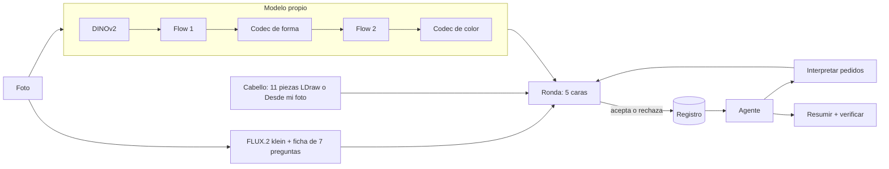

# LEGO Face

LEGO Face convierte la foto de una persona en caras de minifigura LEGO: en cada ronda propone 5 caras y la persona acepta o rechaza cada una. Al terminar, un agente LLM resume la sesión y ese resumen se verifica contra el registro, así que no puede afirmar algo que no ocurrió.

## Carpetas

| Carpeta / archivo | Qué hay |
|---|---|
| `interfaz/` | La app: servidor FastAPI y web Three.js. Ver `interfaz/README.md`. |
| `interfaz/evaluacion/` | Scripts de métricas (CLIP, LPIPS, tiempos, aceptación) y de la prueba de usabilidad. |
| `agente/` | Agente LLM (interpretar, resumir, verificar) y su evaluación en `agente/resultados/`. |
| `notebooks/` | Notebooks del modelo propio: `flow1`, `flow2`, `flow2_color_20k`, `sinteticos` y `vae_cabello`. |
| `docs/` | Arquitectura y currículo de Flow 2 de color. |
| `flux/` | Parte FLUX: cara con FLUX.2 klein, minifig LDraw, cabello y render. Ver `flux/README.md`. |
| `LEGO_Face_Entrega/` | Paquete de entrega: informe (PDF + LaTeX), presentación, video, material del informe y usabilidad. Lo que falta está en `LEGO_Face_Entrega/PENDIENTES.txt`. |
| `Face.zip` | Pesos del modelo propio (`flow1.pt`, `flow2.pt`, `vae1.pt`, `vae2.pt`; Git LFS). Se queda en la raíz: la interfaz lo busca aquí. |
| `LegoFace_Local_Completo.zip` | Código para correr el modelo propio en local. Se queda en la raíz: la interfaz lo busca aquí. |

## Cómo correr

- App: ver `interfaz/README.md`. Antes, descomprime `Face.zip` y `LegoFace_Local_Completo.zip` en la raíz (quedan `Face/` y `LegoFace_Local/`).
- Agente: `python agente/test_agente.py`.

## Cabello

Se elige entre 11 piezas LDraw o «Desde mi foto», que genera el cabello en 3D a partir de la foto (DINOv2, Flow 1 y VAE de cabello). Los pesos están en `interfaz/modelos_cabello/`.

## Cifras clave

| | Modelo propio | FLUX.2 klein |
|---|---|---|
| Parecido foto-cara (CLIP) | 0,562 | 0,567 |
| Diversidad entre las 5 caras (LPIPS) | 0,143 | 0,299 |
| Segundos por ronda de 5 | 18,6 | 102 |

- Flow 1: Dice 0,604. Flow 2: MSE 0,0338.
- Agente: el 100 % de los resúmenes que ve la persona pasa el verificador (ver `agente/README.md`).

## Equipo

- Ana Maria Accilio Villanueva (202120050)
- Rodrigo Félix Meza Gavilán (202220037)
- Josep Ratzinger Castro Ferrer (202220059)
- Jazmin Nicole Soto Quiñonez (202220081)
- Ruben Aaron Coorahua Peña (202110086)

Curso Planificación y Toma de Decisiones en IA, UTEC. Profesor Robert Buleje Del Carpio.
