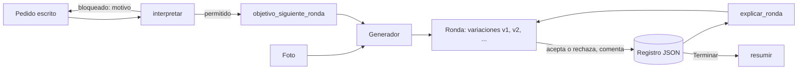
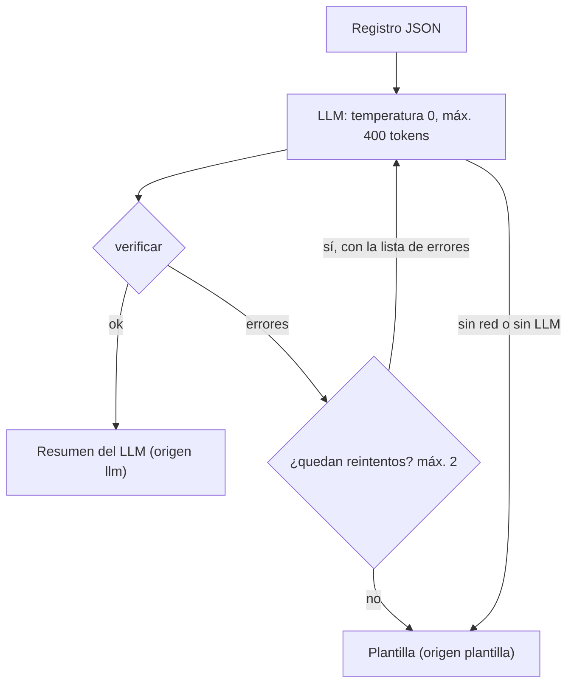
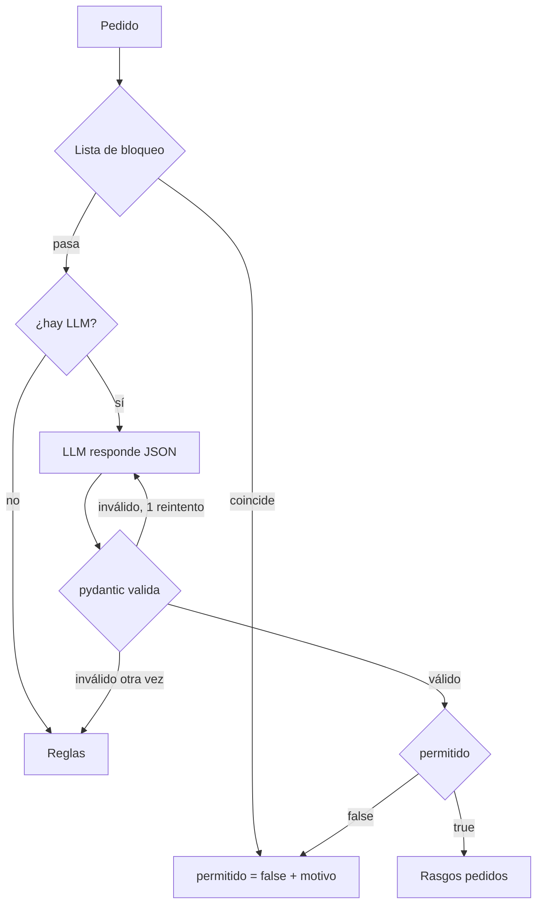

# Agente LLM

Acompaña la generación de caras LEGO: interpreta los pedidos en texto libre, explica cada ronda y, al terminar, resume la sesión.
Cada resumen se verifica contra el registro, así que el agente no puede afirmar algo que no ocurrió. Funciona con un LLM por API, con Qwen2.5 local o sin LLM.

| Archivo | Contenido |
|---|---|
| `agente.py` | `interpretar`, `resumir`, `verificar`, `explicar_ronda`, `objetivo_siguiente_ronda`, plantilla y guardrail |
| `llms.py` | `LLMAPI("groq")`, `crear_llm()` (cadena de respaldo para la app), `cargar_local()` (Qwen2.5-7B en 4 bits o 3B), `LLMFalso` para pruebas |
| `generar_registros.py` | 30 sesiones sintéticas en `registros_sinteticos/` |
| `instrucciones_prueba.csv` | 40 pedidos con su salida esperada (10 deben rechazarse) |
| `evaluar.py` | Métricas por LLM en `resultados/` |
| `agente_kaggle.ipynb` | Evaluación con GPU en Kaggle |
| `test_agente.py` | Pruebas sin red |

## Flujo en la app



## Resumir



`verificar` es determinista. Comprueba que:
- estén los 4 apartados (Aceptadas, Rechazadas, Preferencias observadas, Cambios entre rondas);
- cada variación (`\bv(\d+)\b`) esté solo en su apartado y con su ronda correcta;
- no aparezcan ids inexistentes;
- lentes, barba, bigote o expresión solo se atribuyan a una variación que los tenga en `rasgos_detectados` o en su comentario;
- los conteos de Preferencias coincidan con el registro.

## Interpretar



Se bloquean los pedidos sexuales u ofensivos, los que buscan parecerse a una persona real y los que buscan burlarse de alguien.

## LLM de la app

`crear_llm()` arma una cadena de respaldo: Groq `qwen/qwen3.8-27b`, luego Groq `openai/gpt-oss-20b` (otra cuota) y, si hay una tercera clave configurada, un tercer modelo (ver `llms.py`). Ante un 429 o un error de red pasa al siguiente y salta el que falló 5 minutos; `resumen["llm"]` guarda qué modelo respondió. `evaluar.py` usa un solo modelo.

## Registro de una sesión

```json
{
  "sesion_id": "s_2026-11-18_01",
  "origen": "real",
  "rondas": [
    {"ronda": 1, "instruccion": null, "pedido": null, "variaciones": [
      {"id": "v1", "decision": "aceptada", "comentario": "yo uso lentes",
       "rasgos_detectados": {"lentes": true, "barba": false, "bigote": false, "expresion": "feliz",
                             "cabello": {"color": "negro", "largo": "corto"}}}]},
    {"ronda": 2, "instruccion": "ponle lentes y que se vea más serio", "pedido": {"...": "salida de interpretar"},
     "variaciones": [{"id": "v5", "...": "..."}]}
  ]
}
```

- Los `id` son únicos en toda la sesión: `v1, v2, …` siguen contando entre rondas.
- `decision` es `aceptada` o `rechazada`. `comentario` es `""` si no hay comentario.
- `rasgos_detectados` describe la imagen generada y es la referencia del verificador.
- `instruccion` y `pedido` de la ronda N son lo que se escribió antes de generarla.
- `resumir` agrega `"resumen": {"texto", "origen": "llm" | "plantilla", "intentos", "errores", "llm"}`.

Salida de `interpretar`:

```json
{"rasgos": {"lentes": true, "barba": null, "bigote": null, "expresion": "serio"},
 "cabello": {"color": null, "largo": null}, "permitido": true, "motivo": null}
```

- En los rasgos, `true` es ponerlo, `false` quitarlo y `null` dejarlo como está.
- `expresion` puede ser `feliz | serio | sorprendido | enojado`.
- `cabello.color` puede ser `negro | castaño | rubio | pelirrojo | gris | blanco`.
- `cabello.largo` puede ser `corto | medio | largo`.

## Uso

```python
import json
from agente import interpretar, resumir, explicar_ronda, objetivo_siguiente_ronda
from llms import crear_llm

# Clave GROQ_API_KEY en agente/.env o en Kaggle Secrets. Sin clave devuelve None y la
# app sigue con reglas y plantilla.
llm = crear_llm()

pedido = interpretar("ponle lentes y que se vea más serio", llm)
if not pedido["permitido"]:
    print(pedido["motivo"])                            # no se genera
else:
    objetivo = objetivo_siguiente_ronda(registro, pedido)  # condición para el generador
    # ... generar la ronda, agregarla a registro["rondas"] ...
    print(explicar_ronda(registro, numero_ronda))

texto = resumir(registro, llm)                         # botón Terminar
json.dump(registro, open(f"registros_reales/{registro['sesion_id']}.json", "w", encoding="utf-8"),
          ensure_ascii=False, indent=2)
```

```bash
pip install -r requirements.txt
python test_agente.py
python generar_registros.py
python evaluar.py --llms groq,ninguno          # en Kaggle con GPU: --llms groq,local,ninguno
```
